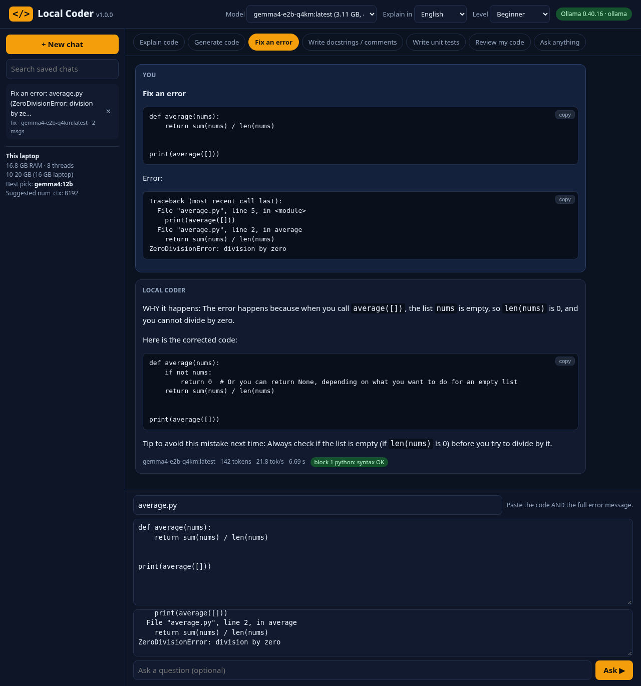
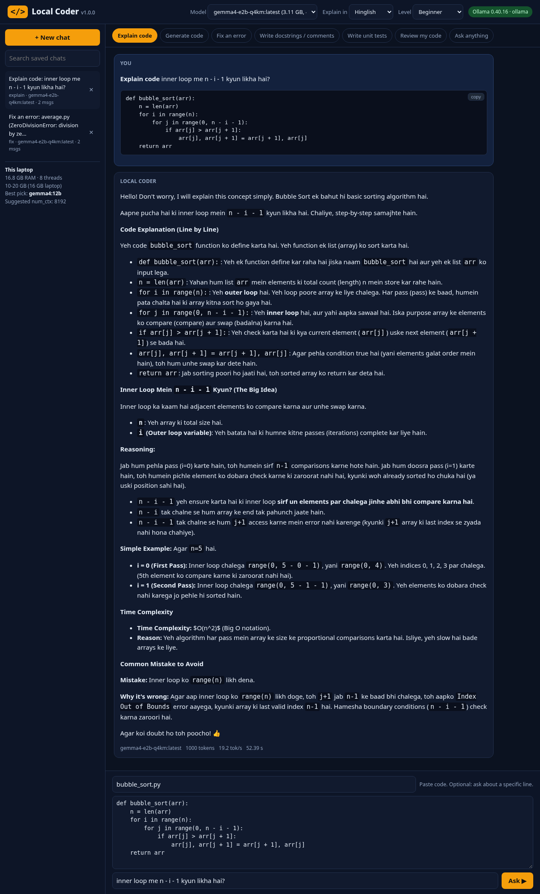
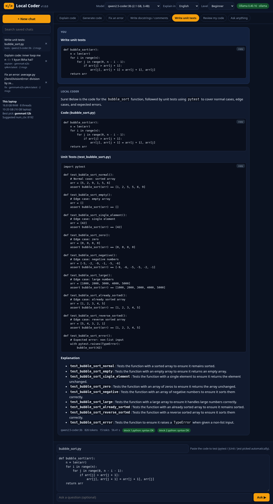
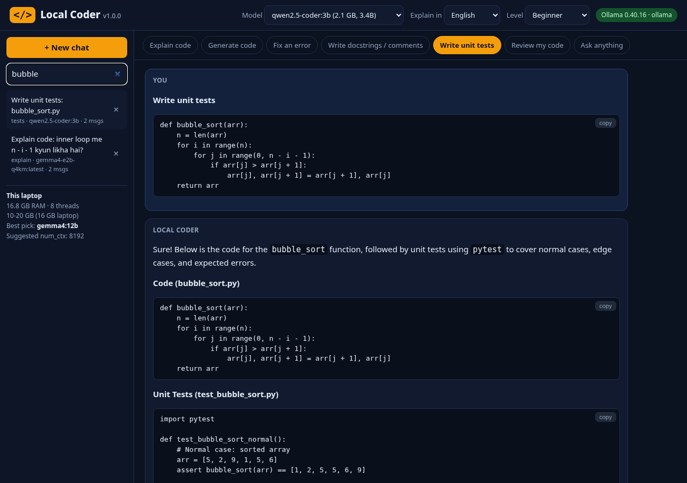
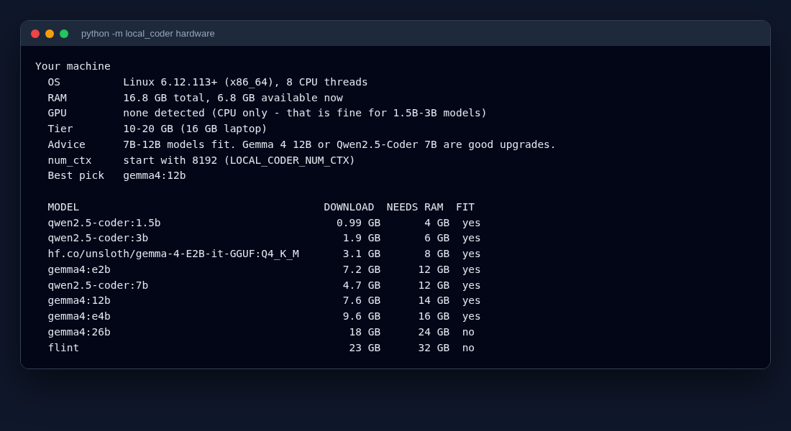
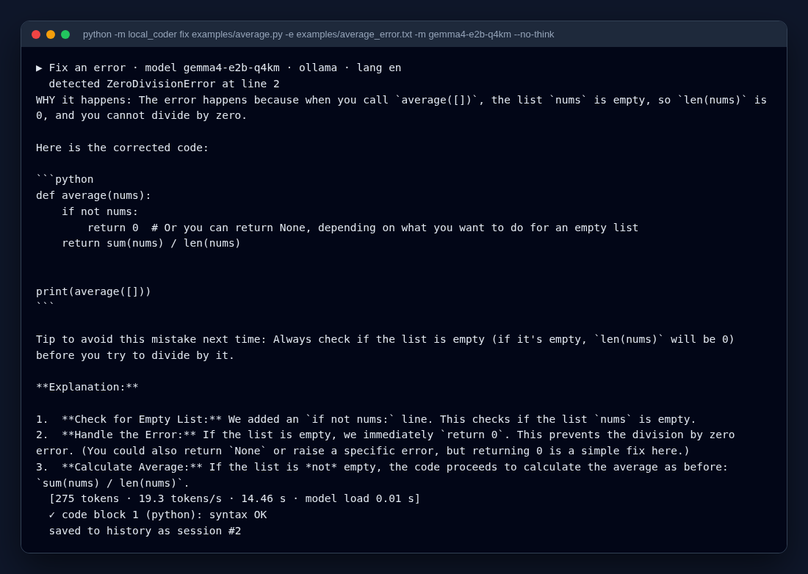
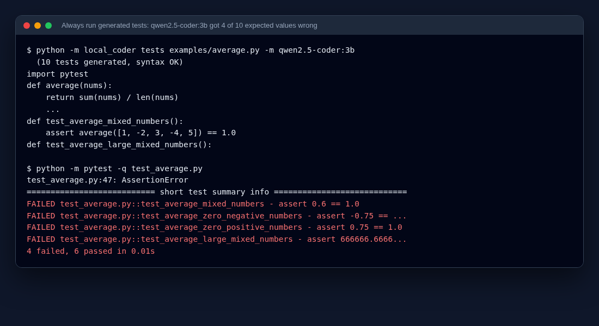

# Local Ollama Coding Assistant (Python) — "Local Coder"

A **local AI coding assistant for students** that runs on your own laptop with
[Ollama](https://ollama.com) and a free open-weight model such as **Gemma 4 E2B**,
**Qwen2.5-Coder** or, on bigger machines, **Recursive Flint**.

It explains code, generates code, fixes errors from a traceback, writes docstrings
and unit tests, and reviews code. You get a chat-style **Flask web UI** and a **CLI**.
Answers stream in as they are written, you can pick the model, and every chat is
saved in a local SQLite file. Explanations can be in **English, Hindi (हिंदी) or Hinglish**.

No API key, no subscription and no internet connection are needed once the model
is downloaded.

📖 Full tutorial: **https://getprojects.org/local-ai-coding-assistant-ollama-python/**



## Features

- **7 modes**: explain, generate, fix an error, docstrings/comments, unit tests, code review, free chat.
- **Error-aware fixing**: parses Python tracebacks, Java stack traces, gcc/g++ errors and JavaScript
  errors. The model is shown the exact line, marked with `>>`, which helps small models a lot.
- **Model picker** for every model installed in Ollama, plus **streaming** answers (SSE in the UI).
- **Saved chat history** in `~/.local-coder/history.db` (SQLite, file mode 0600). You can search it,
  continue a chat, export it to Markdown or delete it.
- **Hindi / Hinglish explanations**, with code and technical terms kept in English.
- **Low-RAM defaults**: `num_ctx` 4096 and temperature 0.2. Long files are trimmed
  (start and end kept), and old chat turns are dropped to fit the context window.
- **Syntax check** of every Python code block in the answer. The code is parsed with `ast`,
  never executed.
- **`hardware` command**: reads your RAM and tells you which model fits (8 GB / 16 GB / 32 GB tiers).
- **`doctor` command**: checks that Ollama is running and the model is installed, and tells you the fix.
- **Safe by default**: the UI listens on 127.0.0.1 only. It refuses a public bind, blocks DNS-rebinding
  Host headers, needs a custom header for POST/DELETE, sets a strict CSP and caps request size.
  It only calls Ollama's read and chat endpoints; it never pulls or deletes models.
- **Offline mock backend** (`--backend mock`), so you can run the demo and all 134 tests without Ollama.

## Which model for my laptop?

| Your RAM | Start with | Download | Notes |
|---|---|---|---|
| 4-6 GB | `qwen2.5-coder:1.5b` | 0.99 GB | close Chrome while it answers |
| **8 GB** | **`qwen2.5-coder:3b`** | 1.9 GB | best all-rounder for coding on 8 GB |
| 8 GB | `hf.co/unsloth/gemma-4-E2B-it-GGUF:Q4_K_M` | 3.1 GB | Gemma 4 E2B, text-only 4-bit; good Hindi |
| 16 GB | `gemma4:12b` or `qwen2.5-coder:7b` | 7.6 / 4.7 GB | noticeably stronger |
| 32 GB+ | `flint` (Recursive Flint 40B-A2.5B MoE) | 23 GB | needs about 26 GB at 4-bit |

Sizes are taken from the Ollama library and Hugging Face pages (checked November 2026).
Run `python -m local_coder hardware` to get advice for your own machine.

## Quick start

```bash
# 1. Install Ollama from https://ollama.com/download and get a model
ollama pull qwen2.5-coder:3b
#    or Gemma 4 E2B as a small 4-bit GGUF straight from Hugging Face:
ollama pull hf.co/unsloth/gemma-4-E2B-it-GGUF:Q4_K_M

# 2. Get the code
git clone https://github.com/GetProjectsIdea/Local-Ollama-Coding-Assistant-Python.git
cd Local-Ollama-Coding-Assistant-Python
python -m venv .venv && source .venv/bin/activate   # Windows: .venv\Scripts\activate
pip install -r requirements-dev.txt

# 3. Check everything
python -m local_coder doctor
python -m local_coder hardware

# 4. Use it
python -m local_coder web                      # open http://127.0.0.1:5050
python -m local_coder explain examples/average.py --lang hi
python -m local_coder fix examples/average.py -e examples/average_error.txt
python -m local_coder tests examples/average.py
python -m local_coder generate "binary search in Java with comments"
python -m local_coder chat                     # interactive, /help for commands
```

No Ollama yet? Run `python -m local_coder demo` or add `--backend mock` to any command.

## CLI reference

| Command | What it does |
|---|---|
| `explain FILE [question]` | Explain code line by line (add `--lang hi` or `--lang hinglish`) |
| `fix FILE -e ERROR_FILE` | Find the root cause of an error and return the fixed code |
| `docstring FILE` | Add docstrings and comments |
| `tests FILE` | Write unit tests (pytest / JUnit 5 / Jest picked from the language) |
| `review FILE` | Friendly code review |
| `generate "task" [--file F]` | Write new code |
| `ask "question"` | One-off question |
| `chat` | Interactive chat (`/mode`, `/model`, `/lang`, `/new`, `/quit`) |
| `models` / `doctor` / `hardware` | Installed models, health check, RAM advice |
| `history list/show/export/delete/clear/stats` | Manage saved chats |
| `web [--port 5050]` | Start the Flask UI |
| `demo` | Offline demo of every mode |

Common options: `--model`, `--lang en|hi|hinglish`, `--level beginner|intermediate|advanced`,
`--num-ctx`, `--temperature`, `--no-think` (faster on Gemma 4), `--no-save`, `--backend mock`.

Environment variables: `OLLAMA_HOST`, `LOCAL_CODER_MODEL`, `LOCAL_CODER_NUM_CTX`,
`LOCAL_CODER_LANGUAGE`, `LOCAL_CODER_LEVEL`, `LOCAL_CODER_HOME`, `LOCAL_CODER_THINK`, `LOCAL_CODER_BACKEND`.

## Screenshots

| | |
|---|---|
|  |  |
|  |  |
|  |  |

## Real model runs (CPU only)

Sample outputs are in [`docs/`](docs/). They were recorded on a cloud VM with an 8-thread Xeon,
no GPU device and Ollama 0.40.16:

- Gemma 4 E2B (Q4_K_M GGUF from Hugging Face): fixed the `ZeroDivisionError` in about 16 s at about 13 tokens/s,
  and explained the code in Hindi at about 20 tokens/s.
- qwen2.5-coder:3b: wrote 10 pytest tests. **4 of them had wrong expected values** (for example
  `average([1, -2, 3, -4, 5]) == 1.0`; the real value is 0.6). See
  [`docs/sample-qwen-generated-tests-pytest-run.txt`](docs/sample-qwen-generated-tests-pytest-run.txt).
  Always run generated tests yourself before you trust them.

## Project structure

```
local_coder/
  config.py         settings from env vars (low-RAM defaults)
  ollama_client.py  Ollama HTTP client (stdlib only, streaming NDJSON) + offline mock
  prompts.py        system/user prompts per mode, English/Hindi/Hinglish, level
  codeutils.py      language detection, traceback parser, code blocks, syntax check, token estimate
  context.py        fit chat history into num_ctx
  history.py        SQLite chat history, search, Markdown export
  hardware.py       RAM detection, model catalogue, tiers
  assistant.py      ties it all together (events: session/token/done/error)
  cli.py, web.py, demo.py, templates/, static/
tests/              134 pytest tests (fake Ollama server, Flask test client)
examples/           buggy average.py + traceback used in the tutorial
docs/               real model outputs + screenshots
```

## Run the tests

```bash
pip install -r requirements-dev.txt
python -m pytest -q
```

## Honest limits

- Small models make mistakes, especially in maths inside tests and in subtle logic. This tool
  syntax-checks Python answers but does not run them. Run and read the code yourself.
- On 8 GB laptops keep `num_ctx` at 4096. Very long files are trimmed in the middle.
- Flint and the 26B+/31B Gemma models are listed for lab machines; they do not fit in 8-16 GB.
- Use it to learn. Your college's rules on AI use for assignments still apply.

## License

MIT © 2026 Pardeep Patel / [GetProjects.org](https://getprojects.org)
